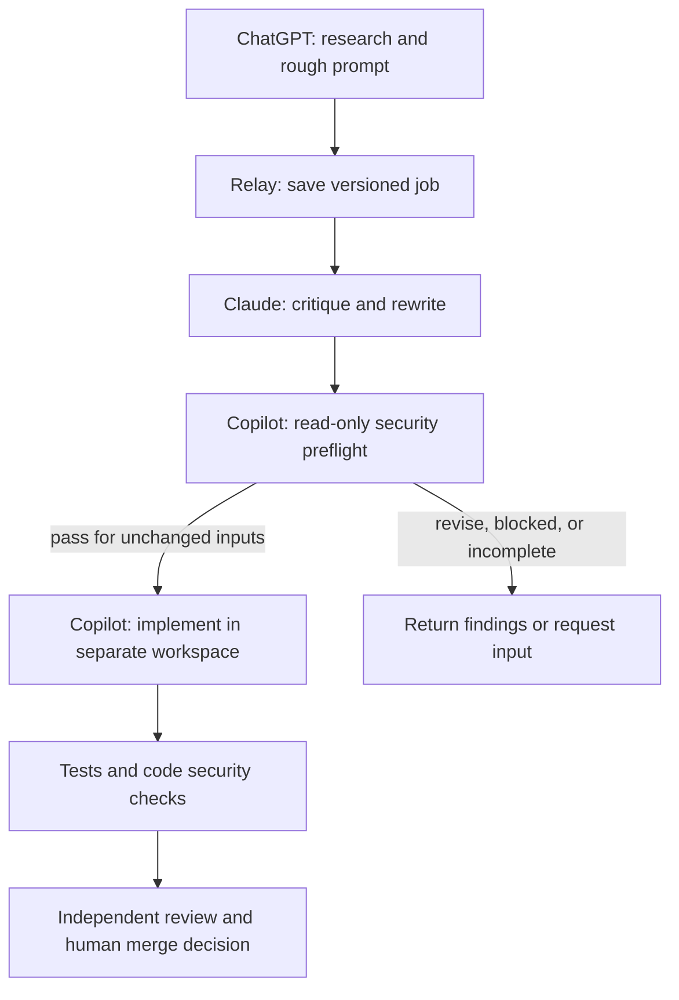

# ChatGPT -> Claude -> Copilot: connection design

Status: investigated design, 2026-10-31. Target entry point: ChatGPT chat, as requested
by the user. No live end-to-end connection is claimed. Repository findings refer to
main commit 823f970804cbb5d427b504dc90be7b0bcaeaf8da.

## Desired user experience

The user asks ChatGPT to research a change. ChatGPT returns a sourced brief and rough
implementation prompt, then submits that work to Relay. Claude critiques and rewrites
the prompt. Copilot checks the revised specification for security issues in a separate
read-only invocation. Only a valid pass permits a new Copilot implementation run.
The result is tested and returned as a pull request for independent review and a human
merge decision.



## Connection choice

Use one coordinator, not shared browser conversations. ChatGPT calls Relay through
MCP; Relay calls the configured Claude and Copilot interfaces and stores their
outputs. Each worker receives the exact artifacts it needs. No worker assumes it
can read another product's chat history, memory, browser login, or connector list.

For the private prototype, evaluate Secure MCP Tunnel with Relay's stdio server.
It supports a local stdio target, but requires tunnel credentials/permissions and
a running client. Its request deadline is 120 seconds: rewriting and implementation
must be jobs that return an identifier promptly, with subsequent status/result calls.
For public distribution, the tunnel documentation requires a publicly reachable HTTPS
MCP endpoint; a private tunnel is a development/private-use route.
Sources: [ChatGPT custom MCP](https://developers.openai.com/api/docs/guides/custom-mcp-server),
[Secure MCP Tunnel](https://developers.openai.com/api/docs/guides/secure-mcp-tunnels).

A public Relay service would additionally need user authentication, repository
authorization, job ownership checks, rate limits and secure credential storage.
Do not expose the existing unauthenticated process as a public command runner.
ChatGPT workspace policy, tool confirmations and tunnel permission are separate checks.

## What currently prevents the sequence

| Boundary | Current implementation | Consequence / needed change |
| --- | --- | --- |
| ChatGPT to Relay | MCP is stdio only; tools are status, plan, approve, tick, pause and resume | No research submission, per-job result or rewrite API. Add these and verify transport. |
| Stages | Agent kinds are claude, codex, copilot and copilot-cloud; modes are plan/build/review | Accept ChatGPT-produced artifacts; add rewrite and security-preflight stages. An OpenAI API adapter is unnecessary when ChatGPT performs research in chat. |
| Context | Plan creates a spec issue, but build receives the task body containing only a spec link | Resolve and freeze referenced research/specification content before the next stage. |
| Continuity | Each local adapter launches a fresh process | Pass explicit context; do not rely on session memory. |
| Claude response | Adapter reads the text result from a JSON envelope | A new rewrite mode needs validated structured output and explicit error handling. |
| Copilot response | Adapter treats stdout as response text | Verify non-interactive invocation and parse completion separately from logs/events. |
| Security | Security appears in the post-build review prompt | Add a pre-build decision enforced by Relay, then retain checks on generated code. |
| Independence | AgentConfig.vendor maps product kind to vendor | Copilot may use an Anthropic model. Record tool, provider and resolved model; unknown identity cannot prove independent review. |
| Async | relay_plan blocks; tick has a background log but no per-job lifecycle | Queue all long stages, persist job IDs/status, handle restart, timeout and cancellation. |
| Cloud pickup | Dispatch assigns an issue; pickup skips draft PRs and depends on issue references | A valid cloud job can appear stuck. Validate a separate cloud adapter and explicit run/PR tracking. |
| Review freshness | Review file is keyed by PR number; review context uses original PR body and truncates the diff | Bind artifacts/review to commits; fetch latest handoff; expose incomplete coverage. |
| Isolation | Worktrees separate files; child processes inherit the host environment | Worktrees are not sandboxes. Restrict stage tools, credentials, startup configuration and filesystem/network access. |

Code evidence: [MCP server](../../relay/mcp_server.py),
[agent adapters](../../relay/agents.py), [configuration](../../relay/config.py),
[workflow](../../relay/workflows.py), [GitHub adapter](../../relay/gh.py).

## Provider-specific constraints

### Claude

Use Claude's programmatic prompt interface, API, or Agent SDK to obtain critique and
rewritten text. `claude mcp serve` exposes tools; it is not a prompt-rewriting endpoint.
Schema output is in `structured_output`, which may be missing; fail closed if absent.
Ordinary headless runs may load hooks and MCP settings from the working directory.
Bare mode changes this behavior and requires API credentials. Choose the execution
mode deliberately and keep rewrite isolated from repository-controlled startup code.
Sources: [headless execution](https://code.claude.com/docs/en/headless),
[MCP server behavior](https://code.claude.com/docs/en/mcp#use-claude-code-as-an-mcp-server).

For a commercial product, do not promise that buyers can use claude.ai subscription
login through Relay. Anthropic's SDK overview requires prior approval for third-party
products offering that login/rate-limit route and otherwise directs developers to API
authentication. Distinguish this from user-operated official CLI workflows.
Source: [Agent SDK authentication guidance](https://code.claude.com/docs/en/agent-sdk/overview#get-started).

### Copilot

Use Copilot CLI for the first adapter. Non-interactive runs require explicitly
available/allowed tools; JSON output is an event stream requiring a dedicated parser.
Pin and record the actual model where available. Authenticate Copilot separately and
check account/organization policy; a successful GitHub connector or GitHub CLI login
does not establish Copilot capability. Never solve tool failures with blanket permissions.
Sources: [programmatic interface](https://docs.github.com/en/copilot/reference/copilot-cli-reference/cli-programmatic-reference),
[command reference](https://docs.github.com/en/copilot/reference/copilot-cli-reference/cli-command-reference),
[authentication](https://docs.github.com/en/copilot/how-tos/copilot-cli/set-up-copilot-cli/authenticate-copilot-cli).

GitHub introduced a new cloud experience on October 28, 2026. It differs from the older
issue-assignment cloud agent. Choose and test one environment explicitly; do not assume
the current assignment/polling implementation controls the new session experience.
Source: [Copilot on GitHub](https://docs.github.com/en/copilot/concepts/copilot-surfaces/copilot-on-github).

### Agensi

Only the latest connected agent app remains active on an account. Keep marketplace
skill loading in the ChatGPT coordinator. Workers use their own provider interfaces;
do not connect every worker to Agensi or copy licensed skill instructions into job
artifacts. Handoffs carry the user's research, task specification and produced results.
Source: [Agensi connection rules](https://www.agensi.io/docs/mcp-setup).
Any licensed instruction forwarding must be assessed against the applicable license.

## Handoff contract

Persist one job with immutable, versioned artifacts. Minimum fields:

- job_id, schema_version, owner/repository identity and current stage;
- objective, citations and research excerpts, assumptions and unresolved questions;
- rough prompt, acceptance criteria and permitted operations;
- Claude critique, revised prompt and rewrite limitations;
- SHA-256 digests of canonical artifact bytes and the repository base commit;
- tool, provider, resolved model, CLI version, execution status and timestamps;
- security decision, findings, limitations and the exact input digests checked;
- implementation branch/commit, test and scan evidence, resulting PR reference.

Keep credentials outside the manifest. Research and remote content are untrusted data;
a source cannot expand the user's authorized operations. Preserve citations and flag
unverified research when later workers cannot browse. Missing context should request
input instead of encouraging a confident rewrite.

Proposed states:

```text
submitted -> rewriting -> awaiting_security -> checking_security -> ready_to_build
          -> building -> validating -> awaiting_review -> completed
```

Transitions above are conceptual: rewriting success enters awaiting_security;
only ready_to_build can enter building. Every stage may instead enter needs_input,
blocked, failed or cancelled. A stage runner claims a job atomically; retries use an
idempotency key and must not duplicate an implementation or PR.

Copilot preflight returns exactly pass, revise, block or incomplete. Pass covers the
revised prompt hash, repository commit and execution-policy hash. Any change to those
inputs invalidates it. Only pass permits implementation, and implementation starts in
a fresh invocation with different permissions. A model-generated pass is advisory
analysis enforced as a workflow prerequisite, not proof the generated code is secure.

Preflight inspects permissions, secrets/data exposure, command execution, dependencies
and external destinations. Implementation remains scoped to the approved task.
Tests, secret/dependency/code scans and independent code review still inspect the result.
Posting results or merging follows the authorization already granted to that job.

## Proposed MCP surface (not implemented)

| Tool | Purpose |
| --- | --- |
| relay_submit_research | Validate and save the user's brief/draft; return job_id |
| relay_start_rewrite | Queue Claude rewrite for a known artifact version |
| relay_start_preflight | Queue read-only Copilot inspection of frozen inputs |
| relay_start_implementation | Enforce current pass and authorized operation scope |
| relay_job_status | Return stage, progress, limitations and action needed |
| relay_job_result | Return authorized artifacts and PR reference |
| relay_cancel_job | Request cancellation and stop subsequent transitions |

Server-side authorization must check job ownership and allowed repository for every
tool. MCP read/write annotations help clients display tools correctly; they are not
authorization. Existing relay_tick mixes merge/review/build, so it is unsuitable as
the sole permission boundary for this staged flow.

## Local readiness observations

Read-only inspection of the current desktop session found Git, GitHub CLI, Codex and
a Copilot executable/shim on PATH. Claude was not found on PATH or in two common install
locations. This does not prove it is absent everywhere.

GitHub CLI auth status did not succeed in this session, although the connected GitHub
plugin can read and write the repository. Standard python/py aliases could not run;
the app's bundled Python 3.12.14 did run. Use a verified interpreter explicitly.

No paid provider request, account sign-in, tunnel provisioning, installation, Copilot
capability test or end-to-end handoff was performed. Desktop sleep/offline state will
also stop a locally hosted runner.

## Smallest next implementation and acceptance checks

1. Transport proof: connect ChatGPT to a read-only Relay health tool and verify the
   intended repository and caller, with no implementation capability exposed.
2. Durable handoff: submit a sourced research brief and draft, return a job ID, read it
   back unchanged, and reject unauthorized job/repository access.
3. Claude round trip: isolated rewrite invocation returns schema-validated critique
   and revised prompt. Preserve sources and acceptance criteria.
4. Copilot preflight: read-only invocation returns a parsed decision. Invalid output,
   unavailable authentication, timeout and refusal stop the job.
5. Enforcement: fail/revise cannot build; editing a prompt, repository commit or policy
   invalidates a previous pass; restart/retry cannot duplicate work.
6. Implementation proof: valid pass enables a scoped branch/worktree run, produces test
   evidence and a draft PR, then returns the result to ChatGPT on status/result request.

Start with steps 1-3 before enabling implementation. A mock can verify state transitions
but cannot establish real-provider connectivity. Record both kinds of evidence separately.
